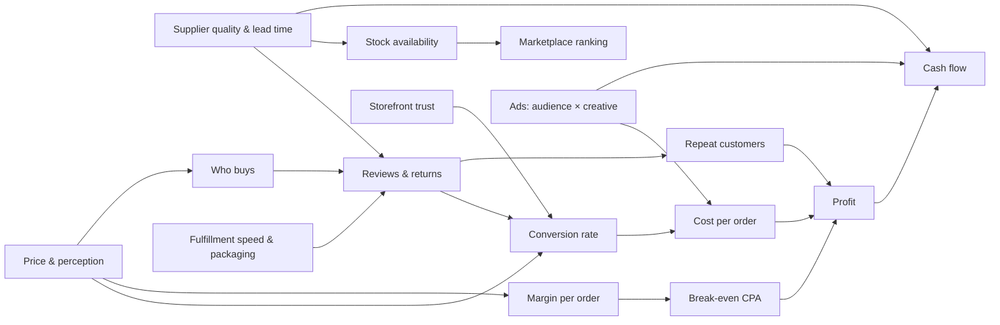

# UNBOXED — Game Concept

*Working title. High-level concept to guide the first build. v0.1*

---

## 1. Pitch

**Unboxed** is a cozy-but-sharp e-commerce tycoon game. You start with a laptop, $4,000 in savings and one corner of a studio apartment, and you finish running a retail company, or a small, beloved premium brand if you'd rather.

Every system is a real e-commerce mechanic turned into a few readable decisions: pick a product, haggle with a supplier, drag together a storefront, test ads, pack boxes. Then watch the numbers and the apartment change as a result. Cardboard spreads across the floor, the first employee turns up with a coffee, and in time a warehouse hums with conveyor belts carrying orders you once taped up yourself.

> **One-line hook:** *From kitchen table to warehouse floor, one box at a time.*

**Design pillars**

1. **Every choice has a visible consequence.** Change a price, swap a photo or pick a supplier, and a number moves *and* something in the world changes.
2. **Few dials, deep play.** Each system has 2–4 meaningful levers. Mastery comes from how the levers interact, not from how many there are.
3. **Growth you can see.** Progress is shown physically in the space, not only in a revenue chart.
4. **Cash is the real boss.** Profit is the score. Cash flow is what decides whether you survive. The game teaches this through play and not through spreadsheets.
5. **Hands-on, then hands-off.** Early tasks are short and tactile. As you grow you automate or delegate them, so your attention moves to bigger decisions.

---

## 2. The Player's Story

**Who you are:** A customizable founder (default name *Sam*, any pronouns) who just left a job they didn't love. You have savings for about four months of runway, a decent laptop and a hunch that you could sell things online.

**Where you start:** A small studio apartment, shown as a cutaway diorama. There's a desk with a laptop, a kitchen table that will become your packing station, a couch, a window and a cat called **Invoice** who will sit in every empty box you ever own.

**Starting resources**

| Resource | Start value | Notes |
|---|---|---|
| Cash | $4,000 | Your savings. Rent ($900) is due every 30 days. |
| Founder Hours | 10 / day | Your time. Packing, support, photography and research all spend it. |
| Space | Apartment corner (≈150 units of stock) | Boxes beyond that spill visibly into the living space and lower your Morale. |
| Reputation | None | No reviews, no followers, no trust yet. |

**The recurring cast** (keeps the business personal)

- **Lin Wei**, account manager at *Brightway Homewares* (Ningbo). Reliable, fair and not the cheapest. She remembers how you treat her.
- **Kevin Zhou** at *QuickMake Supply* (Shenzhen). Fast replies, rock-bottom prices, quality that wobbles. Always "very sorry, my friend."
- **Marta Ruiz** at *Atelier Yunhe*. Premium craftsmanship, high MOQs, slow and worth it.
- **Priya**, a superfan who reviews everything and becomes your first repeat customer.
- **Dale**, who has never once been satisfied but whose complaints are usually *right*.
- **Jordan**, your first hire: a part-time packer who later runs the warehouse if you keep them.
- **Mom**, who places your first order. It counts.

**Fictional world**

| Real-world role | In-game name | Flavor |
|---|---|---|
| Supplier marketplace | **SourceMart** | Supplier directory, samples, RFQs |
| Storefront platform | **ShopBloc** | Drag-and-drop store builder |
| Social feed ads | **Scrollr** | Cheap reach, creative-driven, impulse buyers |
| Search ads | **Seekly** | Expensive clicks with high intent |
| Mega-marketplace | **Bazaarly** | Huge traffic, 15% fees, ruthless on stock-outs |
| Handmade/premium market | **Crafthaus** | Smaller, loyal, rewards brand and quality |
| Discount marketplace | **FlashCart** | Volume on razor-thin margins, price wars |
| Social shopping app | **LoopShop** | Viral spikes, creator partnerships |
| Freight forwarder | **BlueLane Logistics** | Air vs. sea, customs, delays |

---

## 3. Core Loop

```
   ┌──────────────► DISCOVER PRODUCTS ─────────────┐
   │                                               ▼
REINVEST PROFITS                            FIND SUPPLIERS
   ▲                                               │
   │                                               ▼
FULFILL ORDERS ◄──── ATTRACT CUSTOMERS ◄──── CREATE AN OFFER
```

The loop works at two speeds:

- **Micro loop (minutes):** Tweak your offer or ads → watch the day's traffic and orders → pack and ship → read feedback → tweak again.
- **Macro loop (in-game weeks):** Stock runs low → decide how much to reorder, from whom and by air or sea → spend the cash freed up on growth (new product, better store, more ads, a hire, more space).

**Time model:** Real-time with pause and three speeds. At 1× speed one in-game day lasts about 20 seconds. The game auto-pauses on important decisions (a sample arrives, a supplier replies, cash runs low). When nothing urgent is happening, a **"Skip to next event"** button jumps ahead, so waiting on a shipment never wastes real time.

---

## 4. The First 30 Minutes

A concrete walkthrough of what the player does, sees and learns. Times are approximate real-world minutes.

### 0:00–2:00 — The empty desk
The apartment is quiet and the laptop glows. A sticky note on the screen reads: *"Goal: make your first sale."* A short, friendly onboarding introduces the three numbers that matter: **Cash**, **Founder Hours** and **Stock**.

### 2:00–6:00 — Find a product
The **Trend Scanner** app opens with three product cards. Each shows four simple bars:

| Product | Demand | Competition | Margin | Trend lifespan |
|---|---|---|---|---|
| **Glow Planters** (glow-in-the-dark plant pots) | ▰▰▰▰▱ | ▰▰▱▱▱ | ▰▰▰▱▱ | ▰▱▱▱▱ *fad, ~6 weeks* |
| **Slow-Feeder Dog Bowl** | ▰▰▰▱▱ | ▰▰▰▱▱ | ▰▰▰▰▱ | ▰▰▰▰▱ *evergreen* |
| **Aluminum Laptop Stand** | ▰▰▰▰▱ | ▰▰▰▰▰ | ▰▰▱▱▱ | ▰▰▰▰▰ *evergreen* |

There's no wrong answer, but each teaches something different. Glow Planters is a fast sprint that collapses later. The Laptop Stand is a brutal ad auction. The **Dog Bowl** is the balanced, recommended path. (The rest of this walkthrough follows the Dog Bowl.)

### 6:00–11:00 — Source it
On **SourceMart**, three suppliers offer the bowl:

| Supplier | Unit price | MOQ | Quality | Reliability | Production |
|---|---|---|---|---|---|
| QuickMake (Kevin) | $1.90 | 500 | ★★☆ | ★★☆ | 5 days |
| Brightway (Lin Wei) | $2.80 | 300 | ★★★★ | ★★★★ | 7 days |
| Atelier Yunhe (Marta) | $4.60 | 1,000 | ★★★★★ | ★★★★ | 14 days |

The player orders **samples** ($35 each, 4 days). Waiting skips forward with a short montage.

**Sample unboxing (tactile, ~45 seconds):** The three bowls arrive on the kitchen table. You rotate each one and tap to inspect. QuickMake's has a rough mold seam and a faint chemical smell. Brightway's is clean. Marta's is beautiful, with a weighted base. The stars on the table become *your* notes, not the supplier's claims.

**Negotiation (a quick back-and-forth):** You pick Brightway. A two-slider panel sets **Price per unit** and **Order quantity**. Lin Wei counters in a chat bubble, e.g. *"$2.60 is possible at 500 units. At 300 I can do $2.75."* Pushing too hard lowers her **Relationship** meter. Each supplier has a few readable tells (Kevin always folds on price but quietly cuts quality; Lin rewards politeness and repeat orders).

You place the first order: **300 units at $2.75 = $825**, then choose freight:
- **Air:** +$1.20/unit, arrives in **~8 days** ← default for the first order
- **Sea:** +$0.40/unit, arrives in **~30 days**

Cash drops from $3,895 to **$2,710**. The **Cash River** (see §5.7) shows $1,185 flowing into a "Stock in transit" pool.

### 11:00–16:00 — Build the store (while the stock ships)
**ShopBloc** opens as a drag-and-drop canvas. The player assembles a product page from modules:

`Header & Logo` · `Hero Image` · `Photo Gallery` · `Description` · `Reviews` · `Trust Badges` · `FAQ` · `Shipping Info` · `Checkout`

- A **Trust meter** fills as modules are added and improved.
- A **Store Preview** shows a simulated shopper's eye moving across the page, hesitating at weak spots ("No shipping info… is this legit?").

**Photo shoot mini-game (~60 seconds):** Using the Brightway sample, you place the bowl on the kitchen table, choose a backdrop (countertop, wooden floor, white sheet), drag a desk lamp for lighting and optionally add Invoice the cat as a prop (a big boost for pet products). The shot gets a 1–5 star Photo Quality score that feeds directly into conversion.

You name the brand (default suggestion: **"Pawsitive Pace"**), pick colors and a logo style.

### 16:00–19:00 — Set the price
The **Offer panel** has a price slider with live feedback:

```
Price: $29.00        Free shipping: ON
─────────────────────────────────────
Product cost          –$2.75
Freight               –$1.20
Packaging             –$0.60
Shipping to customer  –$5.00
Payment fees          –$1.17
─────────────────────────────────────
You keep per order:   $18.28   ← "Break-even ad cost"
```

A **Perception gauge** (Bargain ← → Premium) moves with the price. $19 feels like a bargain with thin margins. $39 feels premium but needs better photos and reviews to convert. The player can also add a **2-Pack Bundle** ($49) to raise average order value.

### 19:00–23:00 — Launch ads, first sale
Stock arrives. A delivery animation shows **12 boxes stacked in the corner**, and Invoice climbs straight into one.

On **Scrollr**, the player sets up a simple test grid:

| | Creative A: *"Product on white"* | Creative B: *"Dog eating slowly" video* |
|---|---|---|
| **Audience 1: Dog owners 25–45** | test | test |
| **Audience 2: New puppy parents** | test | test |

Budget: **$40/day split across the 4 cells.**

Before ads even start, **Mom buys one.** 🔔 The first-sale moment fills the screen: a chime, confetti, a polaroid pinned to the corkboard wall: *"First Sale!"*

**Packing mini-game (~10 seconds per order):** fold the box, drop in the bowl and a thank-you card (optional, +$0.10, nudges reviews), tape, slap on the label. Early orders feel personal: the label shows the customer's name and city.

### 23:00–27:00 — Read the funnel, kill the loser
After two in-game days, the **Funnel view** shows where money goes:

```
Impressions 18,400 → Clicks 312 → Add-to-cart 22 → Orders 9
Ad spend $80   →   Cost per order (CPA) $8.89   ✅ under $18.28
```

Broken down per cell:
- **B × Puppy parents:** CPA $6.10 🟢 *winner*
- **A × Dog owners:** CPA $41.00 🔴 *burning money*

The player pauses the loser and shifts budget to the winner. *First profitable campaign* milestone unlocks.

The first **review** arrives from Priya: ★★★★☆ *"My pup loves it! Box was a bit crushed though."* This unlocks the **Packaging upgrade** decision (+$0.35/order for sturdier mailers, which reduces damage returns).

### 27:00–30:00 — The hook: the reorder squeeze
Orders are now 12–18 a day. Packing them uses most of your 10 Founder Hours. A notification appears:

> 📦 **Stock runs out in ~9 days. Reorder takes ~15 days (production + air).**
> 💸 **Cash available: $1,640** (ShopBloc pays out sales every 7 days).

The player now faces the first real tension. Reorder **now**, while cash is tight and ads still need fuel? **Cut ads** to protect cash and accept slower growth? Order a **smaller air batch** and a **larger sea batch**? Or **raise the price** to slow sales and stretch the stock?

This is where the first session's real decisions start. It is also the decision the prototype is built around (see §9).

---

## 5. Main Systems

Each system follows the same rule: **2–4 levers, one clear feedback readout, and links to the other systems.**

### 5.1 Product Discovery
**Levers:** which niche, which product, when to drop a fading product.
**Readouts:** Demand, Competition, Margin and Trend Lifespan bars. Later, a **Trend Curve** shows where a product sits on its rise/peak/decline arc.
**Depth:** Fads (short, spiky, high ROI if you're early) vs. evergreens (slow, compounding, brand-friendly). Early products are listed openly. Later niches are hidden and uncovered by spending Founder Hours on research or by hiring a product researcher.
**Example:** *Glow Planters* hit LoopShop virality in week 3. Players who reordered by sea in week 2 receive their stock after the trend has died and are stuck with 1,000 glowing pots. Warning signs: search interest flattening and copycat listings appearing.

### 5.2 Sourcing & Suppliers
**Levers:** supplier choice, negotiated price vs. MOQ, freight mode, quality inspection (paid add-on).
**Supplier stats:** Price · Quality · Reliability · Lead time · Relationship.
**Depth:**
- **Relationship** grows with repeat orders, paying on time and reasonable haggling. It unlocks better terms such as lower MOQs, priority production and eventually **payment terms** (30% deposit, 70% on shipment), which is a huge cash-flow lever.
- **Quality drift:** cheap suppliers sometimes quietly downgrade materials on reorders. A paid **pre-shipment inspection** ($150) catches it.
- **Dual sourcing** reduces risk but splits volume, so you get weaker discounts.

### 5.3 Storefront (ShopBloc)
**Levers:** which modules, quality of each (photos, copy, branding), checkout options.
**Readout:** **Trust score**, which multiplies conversion rate, plus a heatmap-style "shopper's eye" preview.
**Depth:**
- Modules have upgrade tiers. Photos go from phone shot → lightbox → hired photographer → lifestyle video.
- The **Description** is assembled from benefit cards ("Slows eating by 10×", "Dishwasher safe", "Vet-recommended"). Picking the 3 benefits that match your *current audience* beats listing all 8.
- **Checkout** options (express pay, upsell, free-shipping threshold) trade conversion vs. AOV.
- Page clutter is a cost. Each module adds load time, so a page with every module converts *worse* than a focused one.

### 5.4 Pricing & Offers
**Levers:** price, bundles, promotions (discount codes, flash sales), shipping charge vs. free shipping threshold.
**Readouts:** **"You keep per order"** (contribution margin), **Perception gauge** (Bargain ↔ Premium), projected volume.
**Depth:**
- Perception shapes *who* buys. Premium pricing converts better with high-trust stores and wealthier audiences, and draws fewer returns. Bargain pricing draws deal-hunters, who return more and almost never become repeat buyers.
- Too many sales train customers to wait for discounts. A small "Discount Fatigue" meter rises and lowers full-price conversion.
- **Free shipping over $45** pushes bundle adoption, which is one of the cleanest early wins.

### 5.5 Advertising
**Levers:** channel (Scrollr / Seekly / later creators & marketplaces), audience, creative concept, daily budget.
**Readouts:** The **Funnel** (Impressions → Clicks → Carts → Orders) and **CPA vs. Break-even** color coding (green / amber / red).
**Depth:**
- **Test grids:** audience × creative cells with a confidence indicator ("Not enough data yet" → "Likely winner"). Teaches "don't scale on two days of data".
- **Creative fatigue:** winning ads decay over 2–4 weeks. New creative concepts come from your photos, customer reviews (UGC) and eventually hired creators.
- **Scaling penalty:** doubling budget rarely doubles orders. CPA rises as you exhaust the best audience. The game shows this as the audience pool visibly draining.
- **Rising costs:** seasonal CPM spikes (holiday season) and competitor entry push CPA up with warning ahead of time.
- **Where money is lost:** the funnel highlights the leakiest step. A low click rate points to creative, low add-to-cart to the page or price, and cart abandonment to shipping cost or checkout.

### 5.6 Fulfillment, Inventory & Reputation
**Levers:** who packs (you → batch mode → staff → stations → 3PL), packaging tier, shipping carrier speed, return policy, support response.
**Readouts:** Orders backlog, ship time, stock-days remaining, **Star rating**, **Repeat rate**.
**Depth:**
- **Founder Hours** are the early bottleneck. Packing costs ~6 min/order, support tickets ~10 min each. At ~60 orders/day the founder is maxed out and backlog builds, which slows shipping and costs stars. That pressure is what makes the first hire feel earned rather than arbitrary.
- **Customer problems** arrive as short cards with 2–3 responses:
  > **Dale:** "The bowl arrived cracked."
  > → *Refund* (–$29, keeps rating) · *Send replacement* (–$9.55, wins loyalty) · *Ask for a photo first* (saves money, 20% chance of a 1-star review)
- **Reviews** feed back into conversion and organic traffic. **Repeat customers** cost $0 in ads and become the backbone of the premium strategy.
- **Returns** depend on product quality, honest product descriptions (over-promising raises returns) and audience (bargain hunters return more).

### 5.7 Cash Flow (the "Cash River")
The signature UI element. A horizontal river flows left to right:

```
[ Cash in bank ] → [ Stock in production ] → [ Stock in transit ] → [ Stock on shelf ]
       ▲                                                                   │
       └──── [ Payouts pending (7 days) ] ◄── [ Ad spend ] ◄── [ Orders ] ◄┘
```

- Money is shown as little coin-boats moving through pools. When cash sits in "Stock in transit", you can *see* that it isn't available for ads or payroll.
- A **Runway line** projects cash 30 days ahead with known bills (rent, payroll, supplier balances) marked as rocks in the river.
- If the projection dips below zero, the river turns amber and the game offers concrete fixes: *pause ads*, *clearance sale on slow stock*, *ask Lin Wei for payment terms*, *short-term loan at 8%*.
- **Teaching example:** A player whose product goes viral on LoopShop sells 400 units in 4 days, reorders 3,000 units and doubles ads. They are profitable on paper and still can't make payroll on day 12. The game marks it as a lesson, not a failure screen. A rescue option (factoring payouts at a fee, or a family loan with an awkward dinner cutscene) keeps the run alive at a cost.

### 5.8 How the Systems Influence Each Other



**Key chains players will discover:**

| Decision | First-order effect | Knock-on effect |
|---|---|---|
| Cheap supplier | +$0.90 margin/unit | More defects → more returns → lower rating → lower conversion → *higher* CPA |
| Better photos | Trust ↑ | Conversion ↑ → CPA ↓ → can afford to scale ads |
| Raise price $5 | Margin ↑, perception → Premium | Fewer deal-hunters → fewer returns; needs high trust or volume drops |
| Sea freight | Cost/unit ↓ | 3-week longer lead time → stock-out risk → lost ranking, ads wasted on out-of-stock page |
| Scale ads 3× | Orders ↑ | CPA creeps up, Founder Hours overflow, stock depletes faster, cash tied up |
| Hire packer | –$1,400/month | Frees 6+ Founder Hours/day for research, creative and negotiation |

---

## 6. Progression: Apartment to Company

Each stage adds **new decisions**, not just bigger numbers. Moving to the next stage is always **optional**: you get an invitation when you qualify, and you can decline.

| Stage | Space & visuals | New decisions | Unlocks | Advance when… |
|---|---|---|---|---|
| **1. Apartment Startup** | Desk → boxes creep over the couch, the cat claims them | 1–3 products, first store, test ads, hand packing | Batch packing, packaging upgrades, Seekly ads | ~$3k monthly profit *or* 1,000 orders shipped |
| **2. Growing Brand** | Rented garage/small unit with shelving, a packing table and a radio | Reorder cadence, first hires (packer, VA for support), branded packaging, email list & repeat-customer campaigns | Staff, reorder-point automation, customer email flows, LoopShop | $15k monthly profit, 2+ products with steady demand |
| **3. Warehouse Operation** | Small warehouse with racking, packing stations, a forklift and a team in hi-vis vests | Warehouse layout (storage zones, station count), shift staffing, bulk sea freight, replenishment rules, quality inspections | Layout editor, team leads (Jordan), automation (label printers, conveyors), 3PL option | $60k monthly profit, 10k+ orders/month |
| **4. Multichannel Retailer** | Branded HQ with a marketplace "war room" wall of screens | Which marketplaces to join (Bazaarly / Crafthaus / FlashCart), channel-specific pricing and stock allocation, marketplace promotions, fee changes | Marketplace listings, wholesale accounts, volume negotiation with suppliers | $250k monthly revenue across 2+ channels |
| **5. Established Company** | Corporate office + multiple warehouses on a world map | Exclusive/custom products (R&D), manufacturing contracts, international expansion (duties, local warehouses), multi-brand portfolio vs. category focus | Product design studio, factory contracts, regional markets, acquisitions of small brands | Endgame: chase your chosen ambition |

**Delegation curve (attention shifts upward):**

| Task | Stage 1 | Stage 2 | Stage 3+ |
|---|---|---|---|
| Packing | Mini-game per order | One click per batch of 10 | Staff/stations; you set targets |
| Customer support | Each card by hand | VA handles routine cards; you see escalations | Support policy settings (refund threshold, tone) |
| Reordering | Manual | Reorder-point alerts | Auto-replenishment rules you tune |
| Ad testing | Manual grid | Saved test templates | Growth marketer runs tests; you approve scaling |

**Two credible strategies (and everything between):**

- **Boutique / Premium:** Stay in Stage 2–3. High price, Atelier-grade suppliers, small loyal customer base, repeat rate 40%+, low ad dependence, Crafthaus channel. Fewer employees, higher margins, less stress from cash swings, and vulnerable to a single supplier.
- **Volume / Retail:** Push to Stages 4–5. Thin margins, huge throughput, marketplace dominance, massive negotiating power, heavy staffing. Exposed to fee changes, price wars and ad-cost inflation.

**Ambitions (end goals chosen at Stage 3, can be changed):**
- 🏆 **Beloved Brand:** 4.8★ average, 45% repeat rate, $1M annual profit with ≤ 15 staff.
- 🏆 **Retail Giant:** $50M annual revenue across 3+ channels.
- 🏆 **Category King:** #1 share in one category with an exclusive product line.
- 🏆 **Portfolio Builder:** run 4 profitable brands at once.

---

## 7. Visual Style & Rewarding Success

**Art direction:** Warm, isometric cutaway dioramas, like a dollhouse you can peek into. Soft lighting, rounded shapes and a muted palette with bright pops of brand color (your brand color shows up on boxes, tape and eventually staff t-shirts). UI panels look like friendly apps on the founder's laptop. Big numbers, plain words, icons over jargon.

**Progress you can see (the space is the scoreboard):**

- **Stock is physical.** Every 25 units is a visible box. 300 units in a studio means boxes on the couch, then the bed, then the bathtub. Overcrowding is funny *and* a nudge to upgrade.
- **Orders are physical.** Each order is a small parcel that flies out the window (Stage 1), gets picked up by a courier van (Stage 2), or rides a conveyor to a loading dock (Stage 3).
- **People are physical.** Staff have names, idle animations and tiny speech bubbles ("We're out of large mailers!").
- **The corkboard wall** collects polaroid milestones that carry over between spaces, so your first-sale polaroid hangs in the HQ lobby in Stage 5.

**Milestone moments (short, celebratory, skippable):**

| Milestone | Celebration |
|---|---|
| First sale | Chime + confetti + polaroid of the order label |
| First profitable campaign | Ad dashboard cell glows gold, "We have a winner!" stamp |
| First 5-star review | Review card framed on the wall |
| First repeat customer | Priya's second order arrives with a handwritten note |
| First hire | Jordan walks in with two coffees |
| First supplier agreement | Video call with Lin Wei, who sends a gift box |
| First $10k month | The founder pays off the credit card; the apartment lights flicker on brighter |
| Moving day | Time-lapse of boxes leaving the apartment, the cat stays in the last one |

**Audio:** A soft cash-register "ding" on each order that becomes a pleasant, layered rhythm at higher volume (individual dings → chord progression → a gentle music bed that rises with order velocity). Silence becomes a signal that something is wrong.

---

## 8. Challenges & Events

Events are **grounded, foreshadowed and answerable**. Each has a warning sign, a decision window and 2–3 responses with tradeoffs.

| Event | Warning sign | Responses |
|---|---|---|
| **Shipment delay** (port congestion) | BlueLane news ticker: "Ningbo port delays 5–10 days" | Pay for air top-up · Pre-orders with discount · Pause ads to slow sales |
| **Quality drift** | Kevin's reorder came in cheaper and early; returns tick up | Pre-shipment inspection · Switch supplier · Demand partial refund (strains relationship) |
| **Viral spike** | LoopShop creator mentions you; traffic ×8 | Raise price temporarily · Rush reorder · Waitlist (keeps goodwill, loses sales) |
| **Ad costs rise** | CPM forecast shows holiday spike in 2 weeks | Front-load spend · Shift to email/repeat buyers · Raise AOV with bundles |
| **Copycat competitor** | Lookalike listings appear at $19 | Price match (margin hit) · Lean into brand/reviews · Launch upgraded V2 product |
| **Marketplace terms change** | Bazaarly announces fee rise from 15% → 18% next month | Raise marketplace prices · Shift stock to own store · Negotiate volume tier |
| **Return wave** | Description says "fits all breeds"; complaints from giant-dog owners | Fix description · Launch XL size · Accept returns gracefully |
| **Key employee poached** | Jordan's morale is dropping, mentions "an offer" | Raise · Promotion · Let them go and train a replacement |

**No arbitrary disasters.** Random rolls exist, but the *probability* of each event is driven by the player's choices: cheap suppliers raise quality-drift odds, thin stock buffers raise stock-out odds, a single channel raises terms-change exposure.

---

## 9. Playable Prototype: "First Profitable Reorder"

### 9.1 Goal
Prove that the core loop (**product → supplier → offer → ads → fulfillment → reinvest**) is fun, readable and teaches cash flow, inside a **45–60 minute** session.

**Win condition:** Place a reorder of at least 300 units **paid entirely out of profit** from the first batch (i.e. cash in bank after reordering ≥ $4,000 starting savings), without stocking out for more than 3 days.

**Soft fail:** Cash projection hits zero. A "What went wrong" recap shows the Cash River replay and offers a restart from the last decision point.

### 9.2 Scope

**In:**
- Apartment stage only (one diorama, stock-box stacking, cat)
- **One product chosen from 3** (Dog Bowl fully tuned; Glow Planters and Laptop Stand use the same data model with different curves)
- **3 suppliers** with samples, inspection mini-game, 2-slider negotiation, air/sea freight
- **ShopBloc** with 9 modules, 2 upgrade tiers each, photo shoot mini-game
- **Offer panel:** price slider, 2-pack bundle, free-shipping toggle, one discount code
- **Scrollr ads only:** 2 audiences × 3 creatives, daily budget, funnel view, CPA color coding
- **Fulfillment:** packing mini-game → unlock batch packing after 25 orders; Founder Hours
- **Reviews & support:** 6 scripted customer cards (Priya, Dale, Mom + 3 generic) plus procedural reviews
- **Cash River** with 30-day runway projection, rent, payout delay
- **Two events:** one *shipment delay* on the reorder, one *viral bump* (scripted around day 18, then tuned randomly)
- **5 milestones:** First Sale, First Profitable Campaign, First 5★ Review, First Repeat Customer, First Profitable Reorder

**Out (for later):** hiring, new spaces, marketplaces, Seekly, multiple products at once, international, R&D, save slots beyond autosave.

### 9.3 Tuning Baseline (Dog Bowl via Brightway)

| Variable | Value |
|---|---|
| Starting cash | $4,000 |
| Unit cost (300 / 500 / 1,000 MOQ) | $2.75 / $2.60 / $2.35 |
| Freight per unit (air / sea) | $1.20 (8 days) / $0.40 (30 days) |
| Production time | 7 days |
| Packaging (basic / sturdy) | $0.60 / $0.95 |
| Shipping to customer | $5.00 |
| Payment fees | 3% + $0.30 |
| ShopBloc subscription | $29 / month |
| Payout delay | 7 days |
| Default price | $29 (perception: mid) |
| Starting Scrollr CPC / CVR | $0.90 / 2.0% → CPA ≈ $45 🔴 |
| Tuned CPC / CVR (good creative + photos + 3 reviews) | $0.55 / 3.6% → CPA ≈ $15 🟢 |
| Rent | $900 every 30 days |

**Designed learning arc:** The player's first default ad setup **loses money** (CPA $45 vs. break-even $18). They have to fix creative (CPC ↓), photos/reviews/trust (CVR ↑) and possibly add the bundle (break-even ↑) to cross into profit. When the numbers flip from red to green, that is the core "aha" of the prototype.

**Designed cash squeeze:** With ~$2,700 cash after the first order, $40/day ads and a 7-day payout delay, a typical player can't afford a 500-unit air reorder around day 20 unless they've reached profitable CPA. A sea reorder is affordable but arrives too late unless placed early. The optimal-feeling solution is a small air top-up plus a larger sea order, placed around day 14. This is discoverable through the stock-days and Cash River readouts.

### 9.4 Prototype Session Flow

| Phase | In-game days | Real minutes | Player is learning… |
|---|---|---|---|
| Choose product | 0 | 0–4 | Demand vs. competition vs. trend lifespan |
| Samples & negotiation | 1–5 | 4–11 | Quality vs. price vs. reliability |
| Build store & shoot photos | 5–12 (stock shipping) | 11–19 | Trust drives conversion |
| Price & launch | 12–13 | 19–23 | Break-even CPA |
| Ad testing & first orders | 13–20 | 23–33 | Funnel, kill losers, scale winners |
| Reviews, support, packing overload | 15–25 | 30–40 | Quality & service feed demand; Founder Hours limit |
| Reorder decision & delay event | ~14–28 | 35–50 | Lead time vs. cash; air vs. sea |
| Profitable reorder | ~25–35 | 45–60 | Reinvesting profit 🎉 |

### 9.5 Build Notes

**Simulation core (engine-agnostic, data-driven):**
- `Product { demandCurve, baseCVR, returnRate, perceptionRange }`
- `Supplier { unitPriceTiers, moq, quality, reliability, leadTime, relationship, negotiationProfile }`
- `Store { modules[], trustScore() }`
- `Offer { price, bundles[], freeShipping, discount }` → `contributionMargin()`, `perception()`
- `AdCell { audience, creative, budget, cpc, ctr, fatigue }` → daily `impressions → clicks → orders`
- `Inventory { onHand, inTransit[], reorderPoint }`
- `Ledger { cash, pendingPayouts[], scheduledBills[] }` → `runwayProjection(30)`
- `Customer` events drawn from a weighted deck influenced by quality, packaging and audience

Simulate daily ticks with small random variance (±15%) so tests feel noisy but readable. Show **confidence** rather than hiding variance.

**Suggested tech:** A web build (TypeScript + a 2D/isometric renderer such as Phaser or PixiJS, React for the laptop-app UI panels) for fast iteration and easy playtest sharing. Keep the simulation in a pure, UI-free module so it can be unit-tested and headless-balanced with scripted "bot players".

### 9.6 Playtest Questions
1. Can players explain, in their own words, *why* their first ads lost money and what fixed them?
2. Do players notice their cash being locked in stock *before* the game warns them?
3. Is the packing mini-game still pleasant at order 20, and do players feel relief when batch mode unlocks?
4. Do players feel the reorder decision was theirs (not a trap)?
5. After the win screen, do players want to "see what Stage 2 looks like"?

**Success metrics:** ≥ 70% of testers reach the profitable reorder within 60 minutes. ≥ 50% hit the cash squeeze and recover. The median tester can name the break-even CPA concept unprompted.

---

## 10. Open Questions for the Team

- **Session framing:** endless sandbox with ambitions, or a campaign of scenario chapters (e.g. "The Viral Fad", "The Fee Hike") on top of a sandbox?
- **Mini-game lifespan:** should packing/photos stay optionally playable for flavor (and a small quality bonus) after automation?
- **Failure tone:** how forgiving should bankruptcy be? Proposed: always offer one costly rescue per run.
- **Platform target:** PC first (mouse-heavy UI) vs. designing for tablet/mobile from day one.
